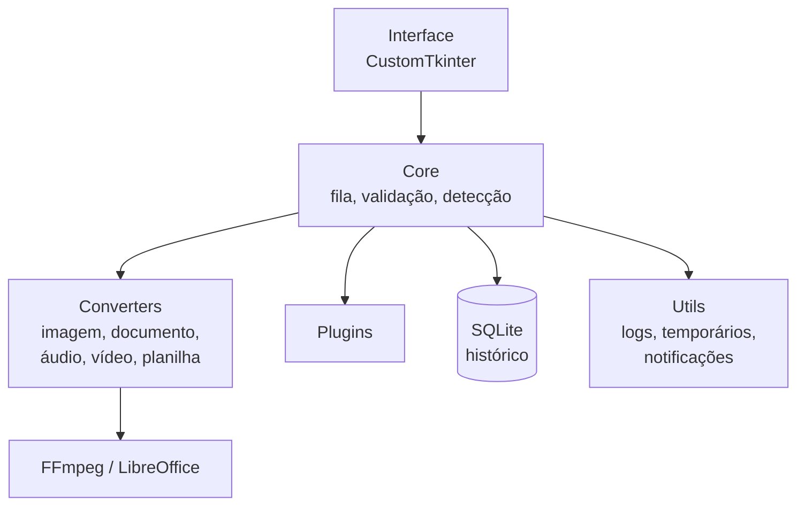

# 🗂️ PyConverter

> Conversor e gerenciador de arquivos desktop em Python: converta, comprima e organize imagens, documentos, áudios, vídeos e planilhas, tudo localmente.


---

## 📑 Sumário

- [Visão geral](#-visão-geral)
- [Formatos suportados](#-formatos-suportados)
- [Funcionalidades](#-funcionalidades)
- [Arquitetura](#-arquitetura)
- [Sistema de plugins](#-sistema-de-plugins)
- [Stack](#-stack)
- [Instalação](#-instalação)
- [Roadmap](#-roadmap)
- [Melhorias futuras](#-melhorias-futuras)
- [Privacidade](#-privacidade)

---

## 🎯 Visão geral

O PyConverter reúne em uma única aplicação desktop o que normalmente exige vários sites e programas diferentes. Os arquivos são processados **no seu computador**, sem enviar nada para servidores externos.

**Princípios do projeto:**

- **Centralizar** conversão, compressão e manipulação em um só lugar
- **Preservar** sempre os arquivos originais, sem sobrescrita acidental
- **Dar controle** sobre qualidade, compressão e formato de saída
- **Automatizar** tarefas repetitivas com lote, filas e perfis
- **Expandir sem quebrar:** novos conversores entram como plugins, sem mexer no núcleo
- **Distribuir** como executável Windows

---

## 📂 Formatos suportados

| Categoria | Formatos |
|---|---|
| 🖼️ Imagens | PNG, JPG/JPEG, WEBP, BMP, TIFF |
| 📄 Documentos | PDF, DOCX, TXT, ODT |
| 🎵 Áudio | MP3, WAV, FLAC, OGG, AAC |
| 🎬 Vídeo | MP4, AVI, MKV, MOV, WEBM |
| 📊 Planilhas | XLSX, CSV, ODS |

> As conversões disponíveis dependem das bibliotecas e ferramentas instaladas e da compatibilidade entre os formatos.

---

## ⚙️ Funcionalidades

### Conversão
- Detecção automática do formato de entrada e sugestão dos formatos de saída compatíveis
- Conversão individual, de vários arquivos ou de pastas inteiras
- Verificação do resultado e detecção de arquivos corrompidos
- Relatório final com arquivos convertidos e com falha

### Fila de processamento
- Adicionar, remover e reordenar tarefas
- Pausar, continuar e cancelar
- Conversões simultâneas com limite configurável
- Reprocessar tarefas que falharam

### Ajustes por tipo de arquivo

| Tipo | O que dá para ajustar |
|---|---|
| Imagens | Resolução, redimensionamento, qualidade, compressão |
| Áudio | Bitrate, taxa de amostragem, canais, qualidade |
| Vídeo | Resolução, bitrate, FPS, extração de áudio, compressão |
| Documentos | Seleção de páginas, extração, união e divisão de PDFs |
| Planilhas | XLSX ↔ CSV ↔ ODS, respeitando as limitações de cada formato |

### Perfis de conversão

| Perfil | Objetivo |
|---|---|
| Melhor qualidade | Priorizar a qualidade do arquivo |
| Menor tamanho | Priorizar a compressão |
| Equilibrado | Balancear qualidade e tamanho |
| Personalizado | Configurar manualmente |

### Organização de arquivos
- Arrastar e soltar, seleção de arquivos e de pastas
- Escolha da pasta de destino e regras de nomenclatura personalizadas
- Detecção de duplicatas e organização por categoria
- Estimativa do tamanho do arquivo convertido

### Histórico (SQLite)
- Registra arquivo original, formatos, data, tamanhos, local de saída, status e erros
- Busca por nome, filtro por categoria e reaproveitamento de configurações
- Limpeza de registros antigos

### Monitoramento
- Progresso geral e por arquivo, tempo estimado, contagem de pendentes, concluídos e falhas
- Notificação ao concluir

### Confiabilidade
- Validação de formatos e tratamento de exceções
- Gerenciamento e limpeza automática de arquivos temporários
- Registro de erros e atividades em log

---

## 🏗️ Arquitetura

A aplicação separa interface, regras de negócio, conversores, persistência e utilitários.



```text
PyConverter/
├── src/
│   ├── core/          # converter, file_detector, validator, queue_manager, plugin_manager
│   ├── converters/    # image, document, audio, video, spreadsheet
│   ├── plugins/       # conversores adicionais
│   ├── interface/     # main_window, components, settings_window, history_window
│   ├── database/      # connection, models, history
│   └── utils/         # file_manager, logger, notifications, temporary_files
├── tests/
├── output/
├── logs/
├── requirements.txt
└── main.py
```

| Módulo | Responsabilidade |
|---|---|
| `core` | Regras centrais, fila, validação e plugins |
| `converters` | Execução das conversões por categoria |
| `plugins` | Expansão de funcionalidades |
| `interface` | Janelas e componentes visuais |
| `database` | Histórico e configurações |
| `utils` | Logs, arquivos temporários, notificações |

---

## 🔌 Sistema de plugins

Cada categoria de conversão funciona de forma independente, o que facilita adicionar formatos, isola funcionalidades e evita dependência direta entre conversores.

```text
plugins/
├── images/         # png_converter.py, jpg_converter.py, webp_converter.py
├── documents/      # pdf_converter.py, docx_converter.py
├── audio/          # mp3_converter.py
├── video/          # mp4_converter.py
└── spreadsheets/   # xlsx_converter.py
```

---

## 🛠️ Stack

| Tecnologia | Uso |
|---|---|
| Python | Linguagem principal |
| CustomTkinter | Interface gráfica |
| Pillow | Imagens |
| FFmpeg | Áudio e vídeo |
| PyMuPDF | PDFs |
| python-docx | Documentos DOCX |
| openpyxl e pandas | Planilhas e dados |
| SQLite | Histórico |
| threading | Execução concorrente |
| logging | Registro de atividades e erros |
| Pytest | Testes automatizados |
| PyInstaller | Geração do executável |

---

## 📦 Instalação

**Pré-requisitos**

- Python 3.11 ou superior
- FFmpeg instalado (conversões de áudio e vídeo)
- LibreOffice instalado (algumas conversões de documentos)

**Passo a passo**

```bash
# 1. Clonar e entrar na pasta
git clone https://github.com/JonnyMarcus/PyConverter.git
cd PyConverter

# 2. Criar e ativar o ambiente virtual
python -m venv venv
venv\Scripts\activate        # Windows (PowerShell/CMD)
# source venv/bin/activate   # Linux/macOS

# 3. Instalar dependências
pip install -r requirements.txt

# 4. Executar
python main.py
```

---

## 🗺️ Roadmap

Cada etapa é implementada e testada antes de avançar para a próxima.

| # | Etapa | Status |
|---|---|:---:|
| 01 | Estrutura inicial do projeto | ⬜ |
| 02 | Manipulação de arquivos | ⬜ |
| 03 | Conversor de imagens | ⬜ |
| 04 | Sistema de validação | ⬜ |
| 05 | Conversor de documentos | ⬜ |
| 06 | Conversor de planilhas | ⬜ |
| 07 | Conversor de áudio | ⬜ |
| 08 | Conversor de vídeo | ⬜ |
| 09 | Conversão em lote | ⬜ |
| 10 | Sistema de filas | ⬜ |
| 11 | Histórico com SQLite | ⬜ |
| 12 | Sistema de plugins | ⬜ |
| 13 | Interface gráfica | ⬜ |
| 14 | Drag and drop | ⬜ |
| 15 | Processamento concorrente | ⬜ |
| 16 | Perfis de conversão | ⬜ |
| 17 | Testes automatizados | ⬜ |
| 18 | Geração do executável | ⬜ |

---

## 🔮 Melhorias futuras

- OCR em imagens e documentos digitalizados
- Suporte a ZIP e RAR
- Recomendação de formato com IA
- Temas personalizáveis e múltiplos idiomas
- Atualização automática
- Estatísticas de conversão e ajustes avançados de desempenho

---

## 🔒 Privacidade

O processamento é local. Os arquivos não saem do seu computador. Ferramentas externas, como FFmpeg e LibreOffice, rodam localmente para algumas conversões.

---

## 📌 Sobre o projeto

Projeto de estudo em Python, arquitetura de software e desenvolvimento desktop, com o objetivo de oferecer uma alternativa local, rápida e segura às ferramentas de conversão online.
